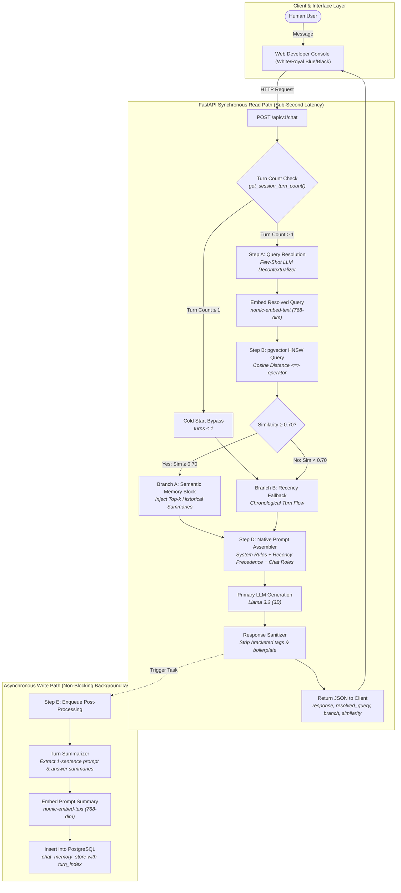
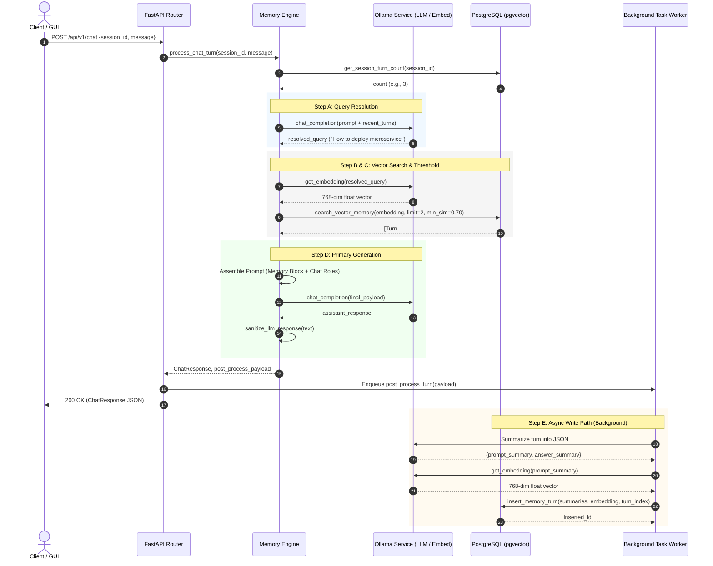

# Detailed Architectural Explanation: Semantic RAG Conversational Memory Engine

## 1. Executive Summary & Problem Formulation

### 1.1 The Context Dilemma in Conversational AI
Modern Large Language Models (LLMs) operate under finite context windows and proportional token pricing. When building persistent, multi-turn conversational agents (e.g., technical assistants, customer service bots, code co-pilots), engineers traditionally face an architectural dilemma:

| Approach | Mechanism | Failure Mode |
| :--- | :--- | :--- |
| **Linear Rolling History** | Concatenate all past raw messages until token limits are reached; truncate oldest turns. | **Context Amnesia:** Decisions made in Turn 1 or 2 are permanently lost by Turn 20, breaking architectural continuity. |
| **Naive RAG on Raw Messages** | Chunk and embed raw chat transcripts into a vector store; retrieve top-$k$ nearest messages. | **Semantic Fragmentation & Pronoun Ambiguity:** A query like *"How do I deploy it?"* fails to match past turns because *"it"* has zero semantic overlap with *"Kubernetes"* or *"Microservice"*. Additionally, stale decisions override recent corrections. |

### 1.2 The Hybrid Solution
This project implements a **Semantic RAG Conversational Memory Engine**. It is a hybrid architecture that pairs:
1. **Long-Term Factual Vector Memory:** Powered by PostgreSQL with `pgvector` and `nomic-embed-text` embeddings operating on *factual turn summaries*.
2. **Short-Term Deterministic Recency Precedence:** An active conversational baseline that tracks conversational state, decontextualizes queries, and guarantees that recent user corrections override older memory chunks.
3. **Decoupled Asynchronous Write Path:** Offloads turn summarization, embedding generation, and vector insertion to non-blocking background workers (`FastAPI BackgroundTasks`), ensuring conversational response latency remains minimal.

---

## 2. End-to-End Execution Flow

### 2.1 Complete Architectural Flowchart



---

## 3. Deep-Dive: Step-by-Step Pipeline Mechanics

### Step 0: The Cold Start Gatekeeper
* **Condition:** Evaluates total turns persisted for `session_id`. If `turn_count <= 1`, vector similarity retrieval is bypassed.
* **Why this matters:** In the first one or two turns of a chat session, there is either no history or only a single introduction. Running vector search and query resolution on cold sessions adds needless network latency and queries an empty or trivial dataset. Cold start routes directly to direct input processing while seeding the conversation baseline.

---

### Step A: Query Resolution (The Pronoun Fix)
* **The Problem:** Human conversation is saturated with indexicals and anaphoric pronouns: *"How do I deploy it?"*, *"What was that database again?"*, *"Show me its config"*. In standard vector search, embedding the string `"How do I deploy it?"` yields vectors positioned around generic questioning rather than the actual topic (e.g., FinTech banking microservice).
* **The Mechanism:** Before touching the vector database, a fast, lightweight LLM call (`llama3.2` with `temperature: 0.0`) rewrites the incoming user prompt into a **self-contained standalone query** conditioned on the immediate last 2–3 messages.

#### Few-Shot Prompt Template:
```text
You are an expert query refactorer for a conversational vector memory engine.
Your ONLY job is to rewrite the user's latest prompt into a concise standalone search query.

CRITICAL RULES:
1. DO NOT answer the question. NEVER return the answer or a single person's name.
2. The output MUST be a standalone search query or question.
3. Replace vague pronouns ('it', 'that', 'this', 'they') with specific entities from history.
4. Output ONLY the rewritten search query. No preamble, no quotes.

Examples:
User: How do I deploy it?
Standalone Query: How to deploy the FinTech digital banking microservice

User: what is your name?
Standalone Query: What is the assistant's name
```

* **Result:** `"How do I deploy it?"` becomes `"How to deploy the FinTech digital banking microservice"`.

---

### Step B: Vector Similarity Search & Mathematical Foundations
1. The standalone query is converted into a **768-dimensional float array** using `nomic-embed-text:latest` via the local Ollama API.
2. The vector is searched against `chat_memory_store` restricted to the current `session_id`.

#### Mathematical Formulation
The vector store evaluates similarity using **Cosine Distance** ($\mathcal{D}_{cos}$):
$$\mathcal{D}_{cos}(\mathbf{u}, \mathbf{v}) = 1 - \frac{\mathbf{u} \cdot \mathbf{v}}{\|\mathbf{u}\|_2 \|\mathbf{v}\|_2} = 1 - \frac{\sum_{i=1}^{n} u_i v_i}{\sqrt{\sum_{i=1}^{n} u_i^2} \sqrt{\sum_{i=1}^{n} v_i^2}}$$

In PostgreSQL with `pgvector`, the cosine distance operator is `<=>`.
Cosine Similarity ($\mathcal{S}_{cos}$) is therefore computed as:
$$\mathcal{S}_{cos} = 1 - (\text{prompt\_embedding} \Leftrightarrow \text{query\_embedding})$$

#### Database Query:
```sql
SELECT id, session_id, turn_index, prompt_summary, answer_summary,
       1 - (prompt_embedding <=> $2) AS similarity
FROM chat_memory_store
WHERE session_id = $1 AND prompt_embedding IS NOT NULL
ORDER BY prompt_embedding <=> $2 ASC
LIMIT 2;
```

#### Thresholding Logic:
* $\mathcal{S}_{cos} \ge 0.70$: High-confidence semantic match. Injected as explicit long-term memory.
* $\mathcal{S}_{cos} < 0.70$: Sub-threshold noise. Discarded to prevent hallucination.

---

### Step C: Branching Context Injection & Recency Arbitration

#### Branch A (Semantic Match Found)
When relevant historical turns cross the $0.70$ threshold, they are compiled into an explicit memory block:
```text
[Relevant Historical Long-Term Memory (via Semantic Match)]
- Past User: Building a FinTech digital banking microservice with PostgreSQL and Kubernetes
- Past Answer: Discussed containerized architecture and deployment via Kubernetes manifests
```

#### Branch B (Recency Fallback / Low Match)
If no turns cross the threshold, the system defaults to the rolling chronological baseline:
```text
[Recent Conversation Chronology & Baseline State]
- User: For authentication, we decided to use OAuth2 with RS256 JWT tokens.
- Assistant: Understood. OAuth2 with RS256 asymmetric keys will secure all endpoints.
```

#### State Overwrite Arbitration (The Override Principle)
A critical flaw in standard RAG is **stale memory persistence**. For example:
* *Turn 1:* User says: *"We are deploying to Kubernetes."* (Stored in vector memory).
* *Turn 4:* User says: *"Change of plans: Ignore Kubernetes, deploy strictly to AWS ECS."*
* *Turn 5:* User asks: *"Where are we deploying?"*

If vector retrieval retrieves Turn 1, a naive LLM might answer *"Kubernetes"*.
To eliminate this failure mode:
1. Recent conversation history is injected as **native chat roles** (`user` / `assistant` pairs) following the system message.
2. The system prompt enforces an invariant rule:
   > *"If the user has made recent state changes, corrections, or constraint overrides, the most recent instructions always take precedence over older historical memory."*
3. Because the LLM encounters the correction in its immediate conversational turns, attention heads assign dominant weight to the recent tokens, successfully overriding outdated vector hits.

---

### Step D: Prompt Assembly & Response Generation
The prompt is constructed as a structured multi-turn message payload:

```json
[
  {
    "role": "system",
    "content": "You are an intelligent, helpful AI assistant.\n[Relevant Historical Memory Block]\nCRITICAL RULES: Answer naturally. Do NOT output headers like [Response]. Recent instructions override older memory."
  },
  { "role": "user", "content": "Recent message N-2" },
  { "role": "assistant", "content": "Recent response N-2" },
  { "role": "user", "content": "Recent message N-1" },
  { "role": "assistant", "content": "Recent response N-1" },
  { "role": "user", "content": "Current Raw User Prompt" }
]
```

#### Response Sanitization
Small language models (e.g. 3B parameters) occasionally leak internal syntax or repeat acknowledgement boilerplate. A regex sanitizer post-processes the raw text:
* Strips stray `[Context Memory Block]` or `[Response]` tags.
* Removes repetitive boilerplate prefixes (e.g., *"I have taken note of your new question..."*).

---

### Step E: Asynchronous Post-Processing (Write Path)
After the LLM response is returned to the user, an asynchronous background task (`memory_engine.post_process_turn`) triggers without blocking the HTTP request:

1. **Factual Summarization:** The latest user message and assistant answer are condensed into 1–2 factual sentences via strict JSON formatting:
   ```json
   {
     "prompt_summary": "User switched container deployment from Kubernetes to AWS ECS Fargate",
     "answer_summary": "Assistant confirmed ECS Fargate deployment plan and deprecated Kubernetes manifests"
   }
   ```
2. **Dense Vectorization:** `nomic-embed-text` generates a 768-dimensional float embedding of the `prompt_summary`.
3. **Database Insertion:** The summary, raw text, embedding vector, `session_id`, and auto-incremented `turn_index` are inserted into `chat_memory_store`.

---

## 4. Sequence Diagram: Component Interaction



---

## 5. Storage Architecture & Index Strategy

### 5.1 Data Model
```sql
CREATE TABLE chat_memory_store (
    id SERIAL PRIMARY KEY,
    session_id VARCHAR(255) NOT NULL,
    turn_index INT NOT NULL,
    prompt_summary TEXT NOT NULL,
    answer_summary TEXT NOT NULL,
    user_message TEXT,
    assistant_message TEXT,
    prompt_embedding VECTOR(768),
    created_at TIMESTAMP WITH TIME ZONE DEFAULT CURRENT_TIMESTAMP
);
```

### 5.2 Why Summary Embeddings Outperform Raw Message Embeddings
* **Noise Filtering:** Raw human messages frequently contain pleasantries (*"hey"*, *"thanks"*, *"okay bro"*) that dilute vector embeddings and skew cosine distances.
* **Clustering Density:** Summaries strictly capture entities, operations, and constraints (*"User specified OAuth2 JWT security"*), producing dense, well-separated vector clusters in 768-dimensional space.

### 5.3 Indexing Mechanics
* **Composite B-Tree (`session_id`, `turn_index`):** Ensures $\mathcal{O}(\log N)$ retrieval for chronological recency queries and turn counting.
* **HNSW Index (`prompt_embedding vector_cosine_ops`):** Builds a multi-layer graph index for Approximate Nearest Neighbor (ANN) search. Searches achieve logarithmic complexity $\mathcal{O}(\log N)$ per query rather than exhaustive $\mathcal{O}(N)$ sequential scans.

---

## 6. Resilience, Fallbacks & Edge Cases

| Scenario | Risk | System Mitigation |
| :--- | :--- | :--- |
| **Embedding Service Timeout** | Ollama embedding endpoint fails or becomes unresponsive. | **Graceful Degradation:** The pipeline catches `httpx.RequestError` or timeout, logs a warning, sets `matches = []`, and automatically falls back to Branch B (linear chronological context). The user never receives a `500 Internal Server Error`. |
| **Database Pool Exhaustion** | High concurrent traffic saturates DB connections. | `asyncpg` connection pool with automatic connection recycling, pre-registered `pgvector` codecs, and parameterized queries. |
| **JSON Summarization Malformation** | Fast LLM outputs unparseable JSON during Step E. | **Extractive Fallback:** If `json.loads()` fails, regex extraction parses fields; if that fails, the engine falls back to truncated raw text to ensure no turn goes unpersisted. |
| **Cross-Session Isolation** | Memory leakage between different users. | Every database read and write is strictly partitioned by `session_id`. Vector searches never evaluate embeddings across different session IDs. |

---

## 7. Performance & Latency Profile

* **Synchronous Turn (Steps A–D):** $\approx 1.2\text{s} - 2.5\text{s}$ (dominated by local LLM token generation).
* **Vector Search Execution (Step B):** $< 5\text{ms}$ (accelerated by HNSW index in PostgreSQL).
* **Background Worker (Step E):** Runs detached in background; adds **0ms** to client HTTP response time.
