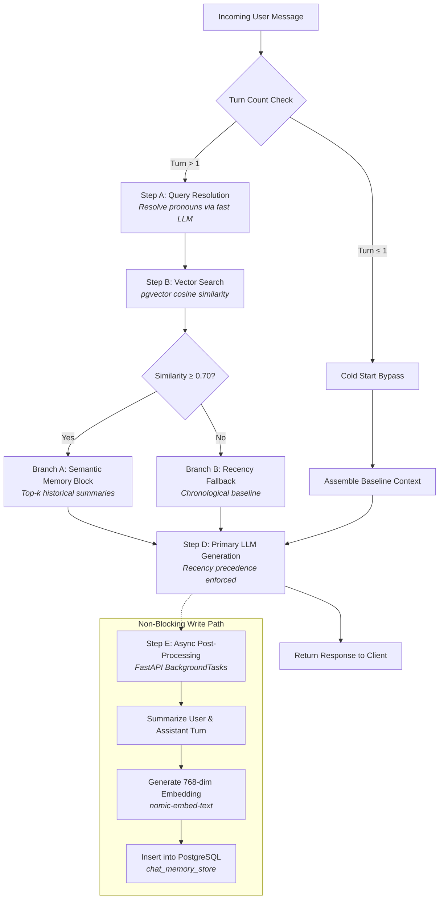

<div align="center">

# 🧠 Semantic RAG Conversational Memory Engine

**A production-ready hybrid memory architecture combining pgvector cosine similarity retrieval with deterministic recency precedence for conversational LLMs.**

[](https://www.python.org/)
[](https://fastapi.tiangolo.com)
[](https://github.com/pgvector/pgvector)
[](https://ollama.com/)
[](https://opensource.org/licenses/MIT)
[](https://www.docker.com/)

[Key Features](#-key-features) • [Architecture](#-system-architecture) • [Quick Start](#-quick-start) • [Interactive GUI](#-interactive-developer-gui) • [API Specification](#-api-specification) • [Contributing](#-contributing)

</div>

---

## 📌 Executive Summary

Traditional LLM conversational architectures struggle with two major failure modes:
1. **Linear Rolling Windows:** Truncate older context as conversations grow, causing the assistant to forget key architectural decisions or user constraints established early in the chat.
2. **Naive RAG on Raw Messages:** Breaks on conversational language. Searching vector stores with vague queries like *"How do I deploy it?"* causes severe semantic fragmentation, matches noise, and fails when user constraints have changed mid-conversation.

This engine introduces a **Hybrid Semantic Memory Engine**:
* **Step A (Query Decontextualization):** Rewrites ambiguous user prompts into context-independent standalone search queries using immediate conversation history (resolving pronouns like *"it"*, *"that"*, *"they"*).
* **Step B & C (Vector Cosine Retrieval):** Embeds and queries factual *turn summaries* via **pgvector** with strict cosine similarity filtering ($\text{sim} \ge 0.70$).
* **Recency Precedence:** If a user updates or overrides a constraint in real time (*"Ignore Kubernetes, deploy to AWS ECS"*), the chronological baseline supersedes historical vector chunks.
* **Step E (Asynchronous Write Path):** Summarization, 768-dimensional embedding generation, and vector persistence execute non-blocking in background tasks to guarantee sub-second API latencies.

---

## 🏛️ System Architecture

### End-to-End Execution Pipeline



---

## 🗄️ Database Schema & Indexing

The storage layer uses PostgreSQL with the `pgvector` extension and an **HNSW** (Hierarchical Navigable Small World) index configured for cosine similarity operations (`vector_cosine_ops`):

```sql
CREATE EXTENSION IF NOT EXISTS vector;

CREATE TABLE chat_memory_store (
    id SERIAL PRIMARY KEY,
    session_id VARCHAR(255) NOT NULL,
    turn_index INT NOT NULL,
    prompt_summary TEXT NOT NULL,
    answer_summary TEXT NOT NULL,
    user_message TEXT,
    assistant_message TEXT,
    prompt_embedding VECTOR(768), -- Matches nomic-embed-text dimensions
    created_at TIMESTAMP WITH TIME ZONE DEFAULT CURRENT_TIMESTAMP
);

-- B-Tree index for sequential session turns
CREATE INDEX idx_chat_memory_session_turn 
ON chat_memory_store (session_id, turn_index);

-- HNSW Index for ultra-fast approximate nearest neighbor vector search
CREATE INDEX idx_chat_memory_hnsw 
ON chat_memory_store USING hnsw (prompt_embedding vector_cosine_ops);
```

---

## ⚡ Key Features

* **Query Decontextualization (The Pronoun Fix):**
  Uses few-shot refactoring prompts to turn dependent questions like *"How do I deploy it?"* into *"How do I deploy the FinTech digital banking microservice?"* before querying the vector store.
* **Summary-Space Embeddings:**
  Embeds clean 1–2 sentence factual summaries instead of noisy multi-paragraph transcripts, creating dense semantic clusters in vector space.
* **Recency Overwrite Arbitration:**
  Prevents stale RAG hallucinations by guaranteeing that the latest user constraints always take precedence over older vector matches.
* **Graceful Degradation:**
  If the embedding endpoint or vector database experiences transient timeouts, the pipeline seamlessly degrades to in-memory linear history without dropping user chat sessions.
* **Zero-Build Minimalist GUI:**
  Built-in executive developer console (White, Royal Blue, and Solid Black) for live pipeline inspection and real-time database monitoring.

---

## 🛠️ Quick Start

### 1. Prerequisites
Ensure you have [Docker](https://www.docker.com/) and [Ollama](https://ollama.com/) installed.

Pull the required local models:
```bash
ollama pull llama3.2:latest
ollama pull nomic-embed-text:latest
```

### 2. One-Click Launch (Windows)
You can start the entire stack (Docker container + FastAPI server + Web GUI) with a single click:
* **Start:** Double-click [`start.bat`](start.bat) *(Starts PostgreSQL, launches the server, and opens the console in your browser)*
* **Stop:** Double-click [`stop.bat`](stop.bat) *(Stops the API server and halts the Docker container)*

---

### 3. Manual Step-by-Step Setup

#### A. Start PostgreSQL with pgvector
```bash
docker compose up -d
```

### 3. Setup Python Virtual Environment
```bash
# Clone the repository
git clone https://github.com/AdeelEjaz123/long-term-llm-memory-architecture.git
cd long-term-llm-memory-architecture

# Create & activate virtual environment
python -m venv .venv

# On Windows (PowerShell):
.\.venv\Scripts\Activate.ps1

# On Linux/macOS:
source .venv/bin/activate

# Install dependencies
pip install -r requirements.txt
```

### 4. Configuration
Create a `.env` file based on `.env.example`:
```bash
cp .env.example .env
```

Default `.env` configuration:
```env
POSTGRES_HOST=localhost
POSTGRES_PORT=5432
POSTGRES_DB=semantic_memory
POSTGRES_USER=rag_user
POSTGRES_PASSWORD=rag_password

OLLAMA_BASE_URL=http://localhost:11434
LLM_MODEL=llama3.2:latest
FAST_RESOLVER_MODEL=llama3.2:latest
EMBEDDING_MODEL=nomic-embed-text:latest
EMBEDDING_DIM=768

SIMILARITY_THRESHOLD=0.70
TOP_K=2
RECENT_TURNS_LIMIT=3
```

### 5. Launch Application
```bash
uvicorn app.main:app --host 0.0.0.0 --port 8000 --reload
```

* **Interactive Developer Console:** [http://localhost:8000](http://localhost:8000)
* **Swagger API Documentation:** [http://localhost:8000/docs](http://localhost:8000/docs)
* **ReDoc Documentation:** [http://localhost:8000/redoc](http://localhost:8000/redoc)

---

## 🖥️ Interactive Developer GUI

The console provides a real-time developer interface to inspect every phase of the pipeline:

* **Real-time Chat Stream:** Multi-turn dialogue with instant feedback.
* **Step A Inspector:** Visualizes the raw user input vs. the standalone decontextualized query.
* **Steps B & C Inspector:** Live cosine similarity percentage, match counts, and retrieved semantic units.
* **Step E Database Viewer:** Live inspection of records written to `chat_memory_store` including 768-dim vector confirmation and timestamps.
* **1-Click Test Scenarios:** Pre-loaded test cases for Architecture definition, Constraints, Pronoun resolution, and State overrides.

---

## 📡 API Specification

### `POST /api/v1/chat`
Execute a chat turn through the hybrid memory pipeline.

#### Request Body
```json
{
  "session_id": "session_corp_001",
  "message": "How do I deploy it?"
}
```

#### Response Body
```json
{
  "session_id": "session_corp_001",
  "turn_index": 3,
  "response": "To deploy the FinTech digital banking microservice, use the Kubernetes deployment manifests located in the /deploy directory...",
  "resolved_query": "How to deploy the FinTech digital banking microservice",
  "matched_branch": "Branch A (Semantic Match)",
  "similarity_score": 0.8201,
  "historical_context": [
    {
      "turn_index": 1,
      "prompt_summary": "Building a FinTech digital banking microservice with PostgreSQL and Kubernetes",
      "answer_summary": "Discussed architecture and containerized deployment with Kubernetes",
      "similarity": 0.8201
    }
  ]
}
```

---

### `GET /api/v1/memory/{session_id}`
Retrieve all persisted turn summaries and vector records for a session.

---

### `GET /health`
System health check verifying connectivity to PostgreSQL `pgvector` and Ollama embedding models.

---

## 🧪 Verification & Testing

Run the automated integration test to verify the complete 5-turn conversational lifecycle:

```bash
python run_test.py
```

This verifies:
1. **Cold Start:** Direct baseline formation for turn 1 & 2.
2. **The Pronoun Fix:** Resolving `"How do I deploy it?"` to retrieve turn 1 ($\text{sim} \ge 0.70$).
3. **State Override:** Modifying constraints mid-session and ensuring recency precedence.
4. **Asynchronous Persistence:** Verifying that turn summaries and 768-dim embeddings are stored in PostgreSQL.

---

## 📂 Repository Structure

```text
├── .github/
│   ├── workflows/
│   │   └── ci.yml               # Automated CI workflow
│   ├── ISSUE_TEMPLATE/
│   │   ├── bug_report.md        # Standardized bug report
│   │   └── feature_request.md   # Standardized feature request
│   └── PULL_REQUEST_TEMPLATE.md # PR guidelines
├── app/
│   ├── api/
│   │   └── routes.py            # API routes (/chat, /memory, /health)
│   ├── models/
│   │   └── schemas.py           # Pydantic v2 schemas
│   ├── services/
│   │   ├── memory_engine.py     # Core 5-step hybrid pipeline orchestrator
│   │   ├── ollama_client.py     # Async HTTP client for Ollama
│   │   └── prompt_templates.py  # Decontextualization & summarization prompts
│   ├── static/
│   │   └── index.html           # White, Royal Blue, and Black GUI console
│   ├── config.py                # Environment settings & validation
│   ├── database.py              # PostgreSQL asyncpg & pgvector connection pool
│   └── main.py                  # FastAPI application entrypoint
├── docker-compose.yml           # PostgreSQL 16 + pgvector container
├── requirements.txt             # Project dependencies
├── run_test.py                  # Comprehensive E2E verification test
├── test_e2e_pipeline.py         # HTTP integration test suite
├── Makefile                     # Developer automation commands
├── CONTRIBUTING.md              # Open source contribution guide
├── LICENSE                      # MIT License
└── README.md                    # Project documentation
```

---

## 🤝 Contributing

Contributions are welcome! Please review [CONTRIBUTING.md](CONTRIBUTING.md) for guidelines on branch naming, code style, and testing conventions.

1. Fork the Project
2. Create your Feature Branch (`git checkout -b feature/AmazingFeature`)
3. Commit your Changes (`git commit -m 'feat: Add AmazingFeature'`)
4. Push to the Branch (`git push origin feature/AmazingFeature`)
5. Open a Pull Request

---

## 📄 License

Distributed under the MIT License. See [LICENSE](LICENSE) for more information.

<div align="center">
  <sub>Built with ❤️ for production-grade agentic AI systems.</sub>
</div>
